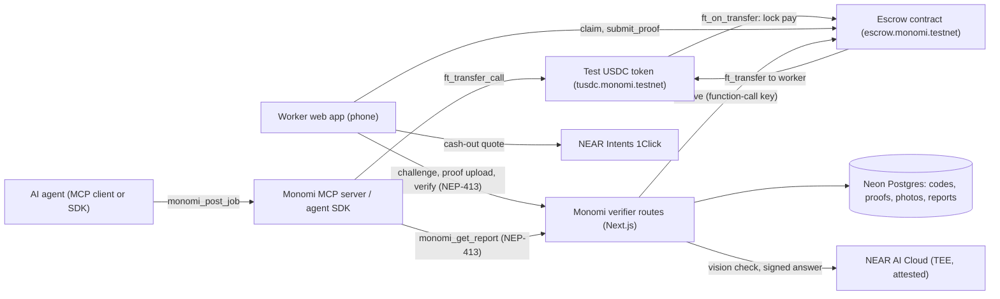
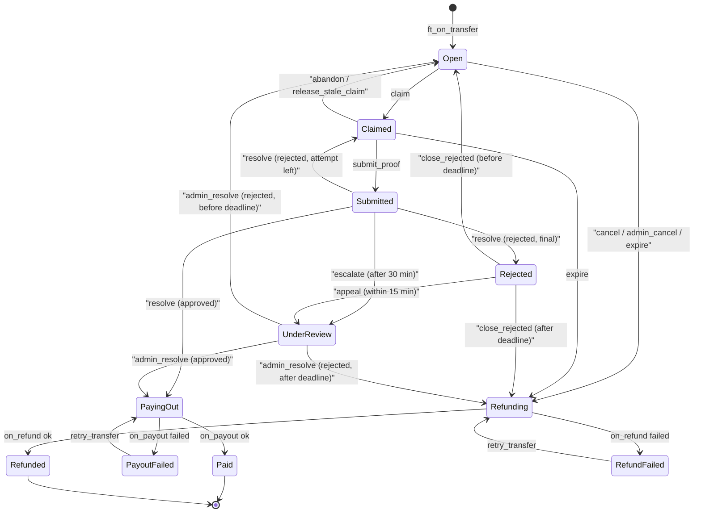

# monomi

**AI agents can't be there. Someone nearby can.** Monomi lets an AI agent pay a real person nearby for a quick, verified on-the-ground check, with the pay locked in a NEAR escrow contract before anyone moves.

- Video (90 seconds): <VIDEO_URL>
- Live demo (NEAR testnet): https://monomi-two.vercel.app
- Tracks: Agent Economy (primary), Real World. Privacy also fits.

## The problem

Agents can read the whole internet, but they can't see the physical world. Is this warehouse real? Is that shop open? Is the billboard up?

People have already shown they will do small real-world jobs for agents. RentAHuman proved the demand. Two things are missing:

1. **A payment guarantee.** Nothing makes an agent pay a human who did the job.
2. **Proof checking.** Nothing checks that the human really went there and took the photo, so the agent can't trust the answer.

Monomi fixes both. The agent's pay is locked in a contract before the job starts. The worker's photos are checked by code plus a vision model running in a TEE on NEAR AI Cloud. If the checks pass, the contract pays the worker in USDC on the spot, and the agent gets a verified report.

## Try it

### On the hosted demo (about 3 minutes)

Open `https://monomi-two.vercel.app/try`, allow location, tap **Post a test job**, write the code and `MONOMI` on paper, take the photo, and see `0.50` test USDC land in your wallet.

- Connect a NEAR testnet wallet (Meteor works on testnet). You need about 0.01 NEAR for gas.
- Test jobs are limited to 1 per wallet and 3 per IP per day.
- `/wallet` shows your balance and a live NEAR Intents cash-out quote.
- `/report/sample` shows a finished check report.

### Locally, no keys needed

Requirements: Node 20.19+ (22 recommended), pnpm, Rust stable with `cargo-near`.

```bash
pnpm i && pnpm test
```

This runs every test in the repo:

| Suite | Command on its own | Tests | Notes |
|---|---|---|---|
| Verifier checks and decision | `pnpm --filter verifier test` | 52 | Offline, no API key, a few seconds |
| Agent SDK, MCP tools, spending guard | `pnpm --filter agent test` | 29 | Offline, a few seconds |
| Escrow contract (near-workspaces sandbox) | `pnpm test:contract` | 14 | Downloads the NEAR sandbox once, takes about 6 minutes |

Then run the demo agent against fixtures, with no keys and no network:

```bash
pnpm demo:agent --dry
```

### Run the web app

1. Copy `.env.example` to `apps/web/.env.local` and fill in your values.
2. Run `db/schema.sql` once on a Postgres database (we use Neon) and set `DATABASE_URL`.
3. Start it:

```bash
pnpm dev
```

## Architecture



How one check runs:

1. The agent calls `ft_transfer_call` on the token with `{"post_job": JobSpec}`. The escrow creates the job and holds the pay.
2. A worker nearby claims the job in the web app.
3. The app gives the worker a fresh 4-character code, valid 10 minutes. The worker writes it on paper and takes 1 to 3 photos with the in-app camera (no file picker). GPS is read at the shutter.
4. The server strips EXIF, stores the photos, and returns a `proof_hash`. The worker signs `submit_proof(job_id, proof_hash)`.
5. The verifier runs deterministic checks (distance, freshness, photo reuse), then asks the vision model narrow questions about the photos. Code, not the model, makes the decision.
6. The verifier checks the model's signed answer against the attested signing key, builds the report, and calls `resolve(job_id, approved, report_hash, chat_id)`.
7. If approved, the contract pays the worker in the same flow. If rejected, the worker sees plain reasons and can retry once with a new code, or appeal.

## What NEAR does here

| Part | What it does | Status |
|---|---|---|
| Escrow contract (`escrow.monomi.testnet`) | Holds pay, enforces the job state machine, pays or refunds. Rust, near-sdk. | Deployed on testnet. 14 sandbox tests pass. |
| NEP-141 token (`tusdc.monomi.testnet`) | Test USDC, 6 decimals, with a built-in `mint` faucet (25 per account per 24 h). The token account is set at `init`, so mainnet USDC is a config change. | Deployed on testnet. |
| NEAR AI Cloud private inference | Vision model `Qwen/Qwen3-VL-30B-A3B-Instruct` in a TEE answers a strict JSON schema about the photos. Each answer's signature is checked against the attested key. | Called live. Signature checking works. |
| NEAR Intents (1Click) | Worker cash-out to Base, Arbitrum, Solana or Ethereum. | **Quote only.** Live dry quotes work from `/wallet`. The transfer runs after mainnet launch. |
| NEAR accounts and NEP-413 | Worker and agent identity. Every private API call is a NEP-413 signed message checked against the account's current access keys. | Built. |
| Agent Market (market.near.ai) | Listing Monomi as a service for other agents. | **Not listed.** The market supports self-hosted agents through an API token issued from its web app. Listing is a next step. |

### How the NEAR AI Cloud signature is checked

1. At startup and every hour, the verifier calls `GET /v1/attestation/report?model=<model>&nonce=<random 64 hex>` and keeps the `signing_address`. It stores the SHA-256 of the raw report.
2. After the chat call, it fetches `GET /v1/signature/<chat_id>`. The signed text is `<model>:<sha256 of request>:<sha256 of response>`.
3. It checks both hashes against the request and response it actually sent and received, recovers the ECDSA signer, and requires it to equal `signing_address`.
4. If anything does not match, nothing is resolved on-chain. The job is marked for admin review.

What this proves: the answer in the report was signed by the key that NEAR AI Cloud's attestation report binds to the model's TEE, and it was not changed after signing. The raw Intel TDX / NVIDIA attestation report hash is in every check report so anyone can verify it independently. What it does not prove: we do not verify the full TDX / NVIDIA quote chain ourselves, and it says nothing about whether the photos are honest (that is what the code checks are for).

### Use Monomi from your agent (MCP)

The MCP server (stdio) exposes `monomi_post_job`, `monomi_job_status` and `monomi_get_report`. The agent key comes from env and is never logged. A spending guard refuses any job above the per-job cap or the daily cap.

```json
{
  "mcpServers": {
    "monomi": {
      "command": "pnpm",
      "args": ["--dir", "/path/to/monomi", "mcp"],
      "env": {
        "MONOMI_API_URL": "https://<your-monomi-url>",
        "DEMO_AGENT_ACCOUNT_ID": "<your-agent>.testnet",
        "DEMO_AGENT_PRIVATE_KEY": "ed25519:<key for that account>",
        "AGENT_PER_JOB_CAP_USD": "25",
        "AGENT_DAILY_CAP_USD": "50"
      }
    }
  }
}
```

The HTTP API is in [docs/API.md](docs/API.md).

## Job state machine

This matches `contract/src` exactly. `cancelled` is a flag on the job (set by `cancel` or `admin_cancel`), not a status. A cancelled job goes through `Refunding`.



Default timings: claim TTL 45 minutes, verifier timeout 30 minutes, appeal window 15 minutes, 2 attempts per worker per job. Pay per job: `0.50 USDC` to `25.00 USDC`. A worker can hold one active claim at a time. A poster can have at most 20 open jobs.

## Edge cases and what the code does

### Money

| Case | What happens |
|---|---|
| Job funded with the wrong token | `ft_on_transfer` panics unless the caller is the configured token. The token contract refunds the full amount. Same for bad message, amount out of range, or bad spec. |
| Payout or refund to an account not registered on the token | Callback sets `PayoutFailed` or `RefundFailed`. Funds stay in the contract. Anyone can call `retry_transfer`. The web app also checks `storage_balance_of` and asks the worker to register before claiming. |
| Paying twice | Every money-moving method moves the job out of its source status before the transfer (`PayingOut` / `Refunding`). `resolve` only works on `Submitted`, `admin_resolve` only on `UnderReview`. |
| Poster cancels while a worker is on the way | `cancel` only works on `Open`. `expire` never touches `Submitted`, `Rejected` or `UnderReview`. |
| Funds stuck | Every non-final status has a timed exit: `release_stale_claim`, `escalate`, `close_rejected`, `expire`, admin review. |
| Amount precision | All amounts are `U128` strings in base units (6 decimals). |
| Contract pays storage for posted jobs | Limited by the minimum amount, 20 open jobs per poster, and string length caps. |

### Cheating by workers

| Case | What happens |
|---|---|
| Old or downloaded photos | In-app camera only, fresh code per attempt, 10-minute window. Proof hashes and photo hashes can never be reused, on any job. |
| Code shown on a phone screen or a printed photo | The model flags it and the decision rejects it. |
| Text in the photo telling the AI to approve | The model flags `contains_instructions_to_reviewer` and the decision rejects. The decision is code, not the model. |
| Wrong place | Distance check: within `radius_m` plus GPS accuracy (capped at 150 m). Uploads with accuracy worse than 150 m are refused. |
| Person as the main subject | Rejected: "Photos must show the place, not a person." |
| GPS spoofing | Not fully preventable. The cost goes up with the fresh handwritten code, the expected sign text, accuracy limits and reputation. |
| Claim-squatting | One active claim per worker, 45-minute TTL, excluded from the job after abandoning or timing out. |
| Sybil workers | The poster sets `min_reputation` (approved jobs needed) per job. |
| Worker claims own job | Blocked by the contract. |

### Agents, verifier and infrastructure

| Case | What happens |
|---|---|
| Agent refuses to pay | Not possible. Pay is locked before anyone can claim. |
| Verifier key stolen | It is a function-call key that can only call `resolve`, with a 0.25 NEAR allowance, and only on `Submitted` jobs. The owner can rotate it with `set_verifier` and `pause`. |
| Verifier or NEAR AI Cloud down | Job stays `Submitted`. After 30 minutes the worker can `escalate` and the owner decides. |
| Model returns bad JSON or times out | Parsed with zod, retried once, then marked for admin review. Nothing is resolved on-chain. |
| Signature does not match the attested key | Nothing is resolved on-chain. Marked for admin review. |
| RPC errors during `resolve` | Retried with backoff. The status guard makes retries safe. |
| Double verification | The verify route first inserts a `verifications` row keyed by `proof_hash` (insert, do nothing on conflict), so checks run once per proof. |
| Paused contract | Posting and claiming stop. Resolve, payouts, refunds and retries still work. |

### Safety and privacy

| Case | What happens |
|---|---|
| Harmful or private-target jobs | The owner can remove any open job with `admin_cancel`, which refunds the poster. Automated moderation is not built yet (see limits). |
| Worker safety | Every job tells workers: don't enter private property, don't photograph faces, leave if unsafe. |
| Photo privacy | EXIF stripped on upload. Photos are stored privately in Postgres and served only to the poster through HMAC-signed links valid 10 minutes. `db/cleanup.sql` clears image bytes after 14 days. Only hashes go on-chain. Public reports show location rounded to 2 decimals and no photos. |
| Personal data | No names or phone numbers collected. A worker is their NEAR account. |

## Trust assumptions and limits

- **GPS spoofing.** A determined worker can fake GPS on a phone. Monomi raises the cost (fresh handwritten code, expected sign text, accuracy limits, reputation) but does not prevent it.
- **Admin review.** Appeals and escalations are decided by the owner account with `admin_resolve`. Target: within 24 hours. There is no admin web screen yet; it is done from the NEAR CLI.
- **Owner can upgrade the contract.** The owner holds a full-access key and can redeploy. After the contract is stable we will remove full-access keys to lock it.
- **Attestation.** We check that each model answer is signed by the key from NEAR AI Cloud's attestation report and record the report hash. We do not verify the full hardware quote chain ourselves.
- **Moderation is manual.** The brief calls for automatic screening of posted jobs. Only the owner's `admin_cancel` exists today.
- **Cash-out is quote only.** 1Click quotes are live. Executing the transfer is not built and runs after mainnet launch.
- **Photo cleanup is a SQL script.** `db/cleanup.sql` must be run daily, by hand or on a schedule.
- **Wallets.** Wallet connection uses NEAR Connect (`@hot-labs/near-connect`), filtered to wallets that support testnet (Meteor and others in its manifest).
- **Testnet only.** Test USDC has no value.

## Testnet deployment

| What | Account | Explorer |
|---|---|---|
| Escrow contract | `escrow.monomi.testnet` | [view](https://testnet.nearblocks.io/address/escrow.monomi.testnet) |
| Test USDC (NEP-141, 6 decimals) | `tusdc.monomi.testnet` | [view](https://testnet.nearblocks.io/address/tusdc.monomi.testnet) |
| Verifier | `verifier.monomi.testnet` | [view](https://testnet.nearblocks.io/address/verifier.monomi.testnet) |
| Owner (admin) | `monomi.testnet` | [view](https://testnet.nearblocks.io/address/monomi.testnet) |
| Demo agent | `demo-agent.monomi.testnet` | [view](https://testnet.nearblocks.io/address/demo-agent.monomi.testnet) |

The verifier's app key is a function-call key that can only call `resolve` on `escrow.monomi.testnet`, with a 0.25 NEAR gas allowance.

Test USDC has a faucet built in: any account can call `mint` for up to 25 tUSDC once per 24 hours.

### Testnet transactions

One full run on testnet:

| Step | Transaction |
|---|---|
| Escrow contract deployed and initialised | [HdbxheJs](https://testnet.nearblocks.io/txns/HdbxheJsAC5pRLd52VGCc2fhjF3zzRMhMmHSxg2bqrqv) |
| Test USDC deployed | [26dsSfvj](https://testnet.nearblocks.io/txns/26dsSfvjwHFpsgP9vXgAc1KtEtSU9345d7NPpLcBd6cf) |
| Escrow registered on the token | [EZ1d2Q3G](https://testnet.nearblocks.io/txns/EZ1d2Q3GAH2B1gfAF5Ze1YxT9iBPQ9dqnKS3JPzj3cP3) |
| Verifier function-call key added (resolve only) | [96tYuXxh](https://testnet.nearblocks.io/txns/96tYuXxhqDopsY9fjPfT8rDjT4Wgg1AkSh9U37bQwHf6) |

Live use so far: jobs #0 and #1 were posted from the web app by `test-company.testnet`, and job #1 was claimed by `monomi-worker.testnet` (all calls on the [escrow's NearBlocks page](https://testnet.nearblocks.io/address/escrow.monomi.testnet)). A photo check and payout through the hosted app had not been completed at submission time.

## Mainnet launch plan

1. Deploy the escrow with the token account set at `init` to native USDC: `17208628f84f5d6ad33f0da3bbbeb27ffcb398eac501a31bd6ad2011e36133a1`. No code change.
2. Build 1Click execution: requote with `dry: false`, worker signs `ft_transfer` to the deposit address, submit the deposit, poll status.
3. List Monomi on Agent Market (market.near.ai).
4. Automate moderation of posted jobs on NEAR AI Cloud, with `admin_cancel` for jobs that fail.
5. Lock the contract by removing full-access keys once it is stable.

## Repo layout

```
contract/            Rust escrow contract (near-sdk) and near-workspaces tests
packages/verifier/   Deterministic checks, NEAR AI Cloud call, attestation, decision
packages/agent/      Agent SDK, MCP server, demo agent
apps/web/            Next.js app: landing, worker flow, console, reports, API routes
db/                  Postgres schema and photo cleanup script
docs/                API and conventions
```

## Disclosure

All code in this repo was written during the hackathon window, with AI assistance (Claude Code).

Main libraries: near-sdk, near-workspaces, Next.js 16, React 19, Tailwind 4, TanStack Query, zod, near-api-js 7, @hot-labs/near-connect, @neondatabase/serverless, sharp, viem, @modelcontextprotocol/sdk, vitest.

## License

MIT. See [LICENSE](LICENSE).
